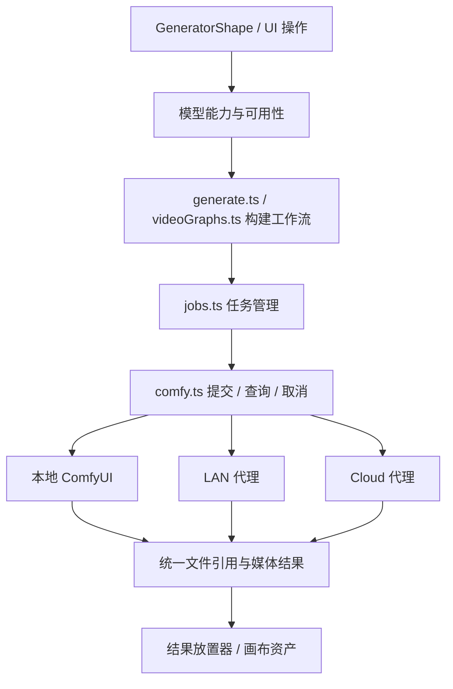
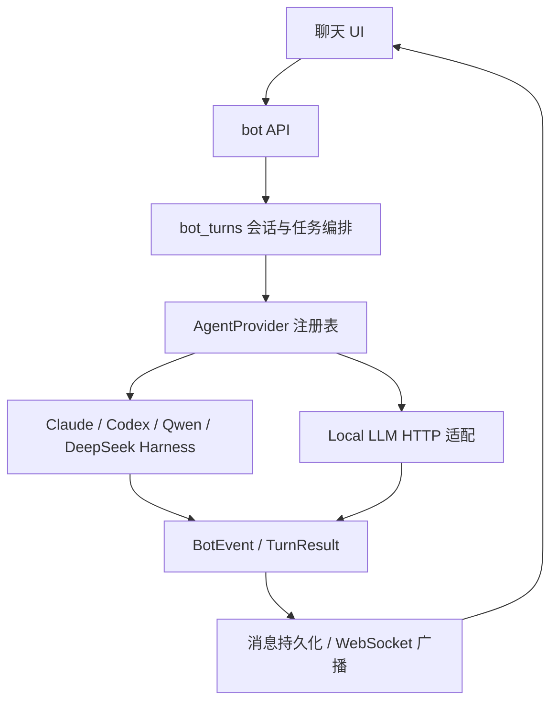

# ComfyArt 多模型接入分层调研

调研日期：2026-10-30。

调研对象：本地 `/Users/jiangxinbo/Documents/github/ComfyArt`，并对照当前 ai-flow 实现。本文基于源码静态阅读，未启动 ComfyArt、未调用供应商、未验证模型可用性或任务恢复的运行效果。代码事实与迁移建议分别说明；本地路径及行号以调研时版本为准。

## 1. 结论

ComfyArt 有两套模型接入体系：图片、视频采用“模型能力描述 + ComfyUI 工作流构建 + 统一任务传输”；Agent 采用真正的 Provider 抽象、注册表与统一会话事件。不能把它描述为一套覆盖全部媒体模型的通用供应商适配器。

最适合 ai-flow 借鉴的部分是：将模型能力、连接配置、协议实现、任务生命周期和画布结果展示分开。媒体生成链路与 Agent 会话链路可共用凭据、日志等基础设施，但不必强行共用同一种请求协议。

## 2. 媒体模型：工作流驱动的分层



### 2.1 模型注册与能力描述

[src/models.ts:8](/Users/jiangxinbo/Documents/github/ComfyArt/src/models.ts:8) 定义 `ModelDef`，字段包括：

| 字段 | 实际作用 |
| --- | --- |
| `id` | 工作流文件标识，而非统一供应商模型 ID |
| `files` | 依赖的本地模型文件，用于判断安装情况 |
| `refs` | 参考图接入方式，如 qwen 或 latent |
| `prompt`、`steps`、`sizes` | 工作流参数注入位置及质量档位映射 |
| `negative`、`control`、`lora` | 负向提示、控制与 LoRA 支持信息 |
| `video` | 媒体类别标记 |

[loadModels](/Users/jiangxinbo/Documents/github/ComfyArt/src/models.ts:76) 并行读取用户偏好、ComfyUI 模型列表和路径映射，推导安装状态。[agentModels](/Users/jiangxinbo/Documents/github/ComfyArt/src/models.ts:93) 根据安装情况和用户允许列表决定 Agent 可选模型。[isInstalled](/Users/jiangxinbo/Documents/github/ComfyArt/src/models.ts:100) 结合本地、LAN 和 Cloud 目标判断可用性。

这里的“可用”并非完整的运行验证：Cloud 模式、安装列表尚未加载或未知模型等分支会直接返回可用，不能据此保证任务一定成功。

### 2.2 参数适配与工作流编译

[generateGraph](/Users/jiangxinbo/Documents/github/ComfyArt/src/generate.ts:117) 从生成器形状读取业务参数，构建或修改 `PromptGraph`，处理提示词、尺寸、参考图、LoRA、质量、视频模式等差异。

[loadNamed](/Users/jiangxinbo/Documents/github/ComfyArt/src/comfy.ts:131) 根据工作流节点标题里的 `@prompt`、`@size`、`@sampler` 等标记查找参数注入点。这样模板可以更换内部节点 ID，业务层仍使用稳定的语义标记。

[customGraph](/Users/jiangxinbo/Documents/github/ComfyArt/src/customWorkflows.ts:40) 对自定义工作流执行标记与输入校验，再填充参数。构建结果使用 [Built](/Users/jiangxinbo/Documents/github/ComfyArt/src/workflows.ts:6)：

```ts
interface Built {
  graph: PromptGraph;
  result: string;       // 结果节点 ID
  partial?: string[];   // 可保留部分结果的节点
}
```

这层适配的是 ComfyUI 图协议，不是 Gemini、万相等异构 HTTP API。它仍然直接读取 `GeneratorShape`，因此尚未完全脱离画布数据模型。

### 2.3 执行目标与传输适配

[queuePrompt](/Users/jiangxinbo/Documents/github/ComfyArt/src/comfy.ts:166) 把执行路由集中到一处：本地 `/prompt`、Cloud 代理或 LAN 代理，返回统一 `prompt_id`。任务 ID 的 `cloud:`、`srv:` 前缀随后用于选择查询和取消路由。

[Cloud 图适配](/Users/jiangxinbo/Documents/github/ComfyArt/api/cloud.py:79) 负责节点类型替换、模型名替换、输入文件上传及特定模型导入。Cloud 结果被下载到本地，并转换为 ComfyUI 文件引用与 history 结构。

[LAN 目标选择](/Users/jiangxinbo/Documents/github/ComfyArt/api/remote.py:182) 结合工作流适配性和负载选择执行实例；代理随后负责上传输入、提交、转发进度、查询及取消。

因此，这条链路通过“保持统一的 ComfyUI 协议 + 目标代理”获得复用，并不是每个模型都实现一个 Provider 类。

## 3. Agent 模型：Provider 抽象与统一事件



### 3.1 核心契约

[bot/providers.py](/Users/jiangxinbo/Documents/github/ComfyArt/bot/providers.py:1) 定义统一数据契约：

| 契约 | 职责 |
| --- | --- |
| `ProviderStatus` | 可用性、版本、登录状态、状态说明 |
| `ProviderCaps` | 是否有会话状态、工具方式、附件支持 |
| `TurnRequest` | 文本、历史、resume token、模型、附件及工具范围 |
| `BotEvent` | 文本、思考、工具调用及结果等统一事件 |
| `TurnResult` | 续接 token、错误、中断和用量 |
| `TurnHandle` | 运行进程引用及停止请求 |

[AgentProvider](/Users/jiangxinbo/Documents/github/ComfyArt/bot/providers.py:62) 约定 `probe`、`capabilities`、`list_models`、`model_options`、`send`、`stop`。具体实现集中在 [api/providers.py](/Users/jiangxinbo/Documents/github/ComfyArt/api/providers.py:12) 注册。

路由和会话编排通过 provider ID 查找实现，不需要通过模型显示名称推断 CLI 或 HTTP 协议。

### 3.2 会话编排与 UI 解耦

[bot status API](/Users/jiangxinbo/Documents/github/ComfyArt/api/bot.py:12) 返回模型列表、供应商可用性、附件和分支能力；前端使用 [ProviderInfo](/Users/jiangxinbo/Documents/github/ComfyArt/src/bot.ts:40) 渲染选择界面。

[会话执行器](/Users/jiangxinbo/Documents/github/ComfyArt/api/bot_turns.py:160) 根据 `stateful` 决定传递历史还是复用会话 token，统一消费 Provider 事件、周期保存消息、广播增量、记录完成状态并推进队列。

供应商差异留在适配器中。例如 [LocalLlmProvider](/Users/jiangxinbo/Documents/github/ComfyArt/bot/local_llm.py:54) 实现模型发现和 HTTP 调用；CLI Provider 封装参数、进程启动、输出解析和终止。UI 不直接解析供应商原始事件。

## 4. 配置与凭据边界

ComfyArt 将普通配置与主要凭据来源分开：

- [api/settings.py](/Users/jiangxinbo/Documents/github/ComfyArt/api/settings.py:5) 保存功能开关、默认模型、Local LLM URL 等配置，并校验键、类型及部分枚举。
- [Cloud 请求头](/Users/jiangxinbo/Documents/github/ComfyArt/api/cloud.py:32) 从服务端 `COMFY_API_KEY` 环境变量读取凭据。
- [Local LLM 请求头](/Users/jiangxinbo/Documents/github/ComfyArt/bot/local_llm.py:68) 从服务端环境变量读取 API Key，base URL 通过配置回调注入。
- CLI Provider 使用服务端认证目录，例如 [Codex 认证目录解析](/Users/jiangxinbo/Documents/github/ComfyArt/bot/codex.py:252)。

这些做法说明了前后端边界，但不能视为完整的多租户凭据系统。实例、配置和认证目录的隔离需按部署方式重新设计。[LAN HTTP 会话](/Users/jiangxinbo/Documents/github/ComfyArt/api/remote.py:59) 关闭 TLS 证书校验，此设置不适合照搬到公网供应商请求。

## 5. 异步任务、结果与恢复

媒体任务使用统一的提交、查询、取消和结果放置流程：

- [comfy.ts](/Users/jiangxinbo/Documents/github/ComfyArt/src/comfy.ts:208) 使用 WebSocket 完成/错误事件唤醒等待，并以 1500ms 定时轮询兜底。
- [promptHistory](/Users/jiangxinbo/Documents/github/ComfyArt/src/comfy.ts:231) 根据任务 ID 路由查询，统一处理 HTTP 错误。
- [waitForOutput](/Users/jiangxinbo/Documents/github/ComfyArt/src/comfy.ts:240) 统一检查执行失败、中断、结果缺失和任务丢失；媒体与文本通过不同提取器复用等待逻辑。
- [startJob](/Users/jiangxinbo/Documents/github/ComfyArt/src/jobs.ts:200) 把任务 ID、结果节点、媒体类型、placer 等写入形状 metadata。
- [resumeJobs](/Users/jiangxinbo/Documents/github/ComfyArt/src/jobs.ts:252) 重新扫描形状中的任务记录恢复等待，删除形状时尝试取消关联任务。
- [registerPlacer](/Users/jiangxinbo/Documents/github/ComfyArt/src/jobs.ts:39) 允许不同业务注册结果放置器，将执行与结果呈现部分拆开。

输出经过 `ImageRef → Media → 画布资产` 归一化，业务无需直接处理 Cloud 的临时结果格式。

在检查的主路径中，没有看到完整的统一指数退避、提交幂等和全局任务 deadline。`waitForOutput` 可以持续循环，查询网络失败会抛错；不能把这套代码描述为已经解决可靠执行的全部问题。ai-flow 还需处理提交成功但客户端未收到响应、形状删除与提交完成竞态、停止后结果回传等情形。

## 6. 与 ai-flow 的对照

| 维度 | ComfyArt 的实际实现 | ai-flow 当前实现及改进点 |
| --- | --- | --- |
| 模型描述 | 工作流能力表；Agent 另有供应商能力接口 | 模型注册信息较少，可增加输入类型、参数范围和异步能力 |
| 协议选择 | 媒体按执行目标代理；Agent 按 Provider ID 注册 | 部分 API 按模型名称或 URL 推断协议，应显式声明 adapterId |
| 模型目录 | 媒体偏好、安装状态和 Agent 目录各自管理 | 浏览器自定义定义与服务端配置读取来源不一致，需统一服务端目录 |
| 凭据 | 主要从服务端环境变量或 CLI 认证目录读取 | 模型配置接口返回包含 key 的配置，应区分公开 DTO 与服务端配置 |
| 任务管理 | 统一提交、等待、取消、恢复 | 视频生成在单个请求中等待并转存，需建立独立任务生命周期 |
| 结果展示 | 统一文件引用、Media 和 placer | 可抽离 ArtifactService，与节点更新解耦 |

ai-flow 证据：

- [图片 API](/Users/jiangxinbo/Documents/workspace/ai-flow/app/api/generate/image/route.ts:228) 通过 Banana/Flux 名称以及 dashscope URL 分流。
- [模型注册表](/Users/jiangxinbo/Documents/workspace/ai-flow/lib/model-registry.ts:97) 从浏览器 localStorage 加载自定义模型；服务端不能通过该函数读取同一份浏览器配置。
- [数据库配置](/Users/jiangxinbo/Documents/workspace/ai-flow/lib/db/model-configs.ts:16) 返回含 `key` 的对象，[模型配置 GET](/Users/jiangxinbo/Documents/workspace/ai-flow/app/api/model-config/route.ts:10) 直接返回配置数据。
- [视频 API](/Users/jiangxinbo/Documents/workspace/ai-flow/app/api/generate/video/route.ts:237) 在一个请求中串行生成、等待结果并上传 OSS。

## 7. 建议迁移到 ai-flow 的架构

本节是设计建议，不表示 ComfyArt 已按此实现。

```text
节点 UI / Agent
  → ModelCatalog：公开模型能力、参数和配置状态
  → GenerationService：输入校验、幂等与任务生命周期
  → AdapterRegistry[adapterId]：选择协议实现
  → Gemini / DashScope / Generic 等适配器
  → ArtifactService：结果归一化与 OSS 转存
  → 任务状态订阅 / 节点结果更新
```

核心数据应拆成三类：

| 数据 | 建议内容 |
| --- | --- |
| `ModelDefinition` | 稳定 modelKey、供应商模型 ID、adapterId、能力与参数 schema |
| `ProviderConnection` | 服务端 baseUrl、credentialRef、超时和连接配置 |
| `GenerationTask` | taskId、供应商任务 ID、状态、进度、输入快照、错误与产物 |

节点组件提交与 React Flow 类型无关的生成请求 DTO。后端重新校验能力和参数；不能只靠前端隐藏不支持的控件。模型显示名允许修改，稳定 key 用于旧工作流兼容。

统一 Artifact 建议携带 `kind/url/mimeType` 等信息；统一错误建议携带 `code/retryable/providerRequestId`。具体供应商原始字段可保存在适配器日志或任务扩展字段中，不扩散到所有节点组件。

适配器需要区分直接返回结果与异步提交两种模式。并非每个供应商都支持查询、进度或取消，应在能力描述中明确表达，不用空实现假装支持。

## 8. 落地顺序与验收

1. **统一模型目录和 adapterId。** 服务端成为模型配置的权威来源，保留旧模型 key 映射。用现有 Gemini、万相和通用协议构造契约样例，验证新增模型不再要求修改路由名称判断。
2. **拆分公开配置与服务端凭据。** 前端读取能力与 `configured/hasCredential` 状态；修改凭据使用专门输入。验证模型列表、工作流导出和日志不包含密钥。
3. **抽离生成服务与任务记录。** 路由仅负责校验入口和返回结果/任务 ID，任务服务承担状态转换、查询、取消与恢复。验证刷新恢复、超时、重复提交、取消后迟到结果及失效节点。
4. **统一产物和错误。** 将 OSS、缓存和结果归一化放在明确的服务边界，验证不同供应商结果对节点展示一致，临时 URL 的有效期与转存失败可表达。
5. **由能力驱动 UI。** 让参考图数量、首尾帧、时长、分辨率等使用模型能力定义，同时保留后端校验。

测试应优先覆盖协议适配、任务状态机和兼容迁移；真实供应商验证需要配置后另行执行。对于创建计费任务的请求，不能在没有幂等保障时自动重试提交。

## 9. 适用边界

不直接移植 ComfyArt 的 PromptGraph 编译逻辑到 ai-flow 的 HTTP 模型调用层；不将 Agent Provider 契约原样套用到图片、视频任务；不将环境变量凭据方案直接宣称为多租户方案。

多模型接入重构可与画布性能优化独立推进。它不应成为修复当前高频持久化和全量状态订阅问题的前置条件。
